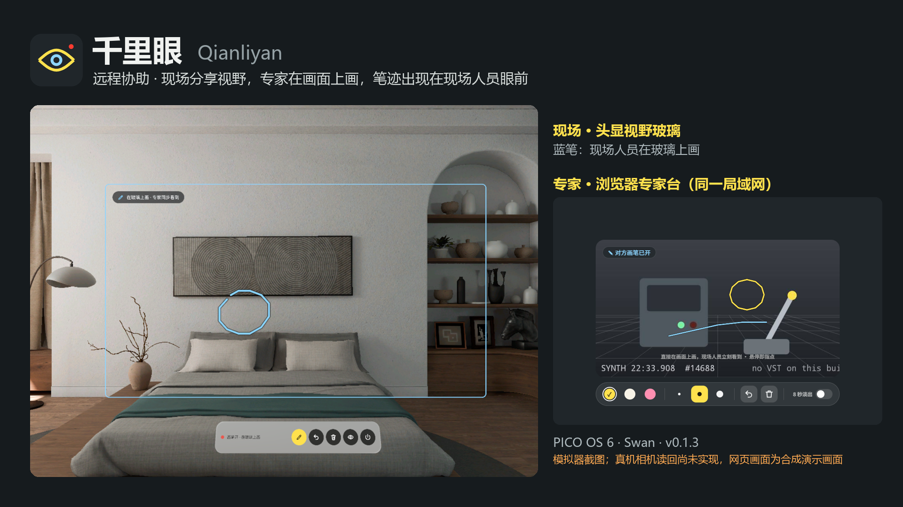
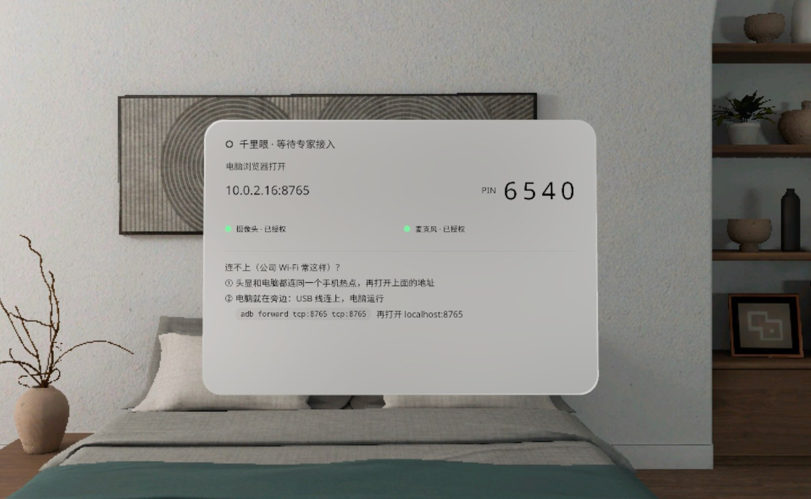
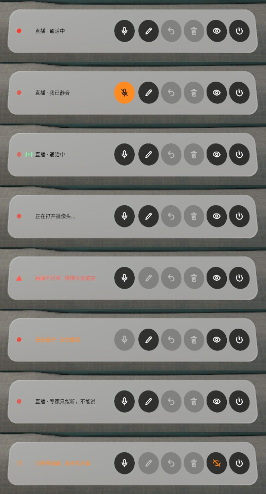
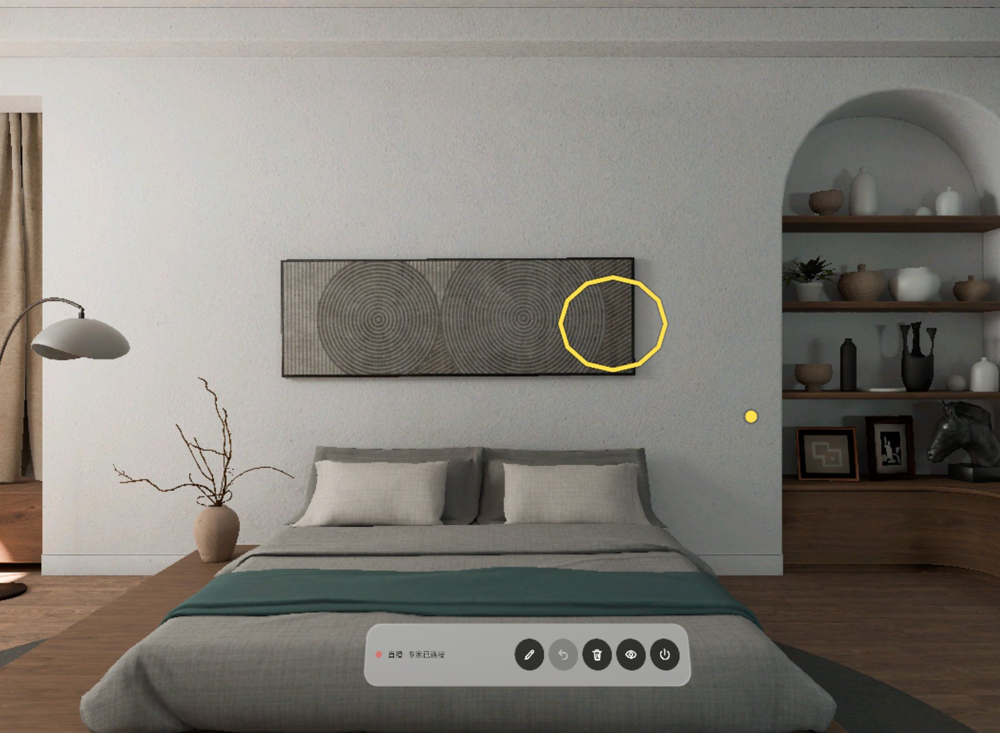
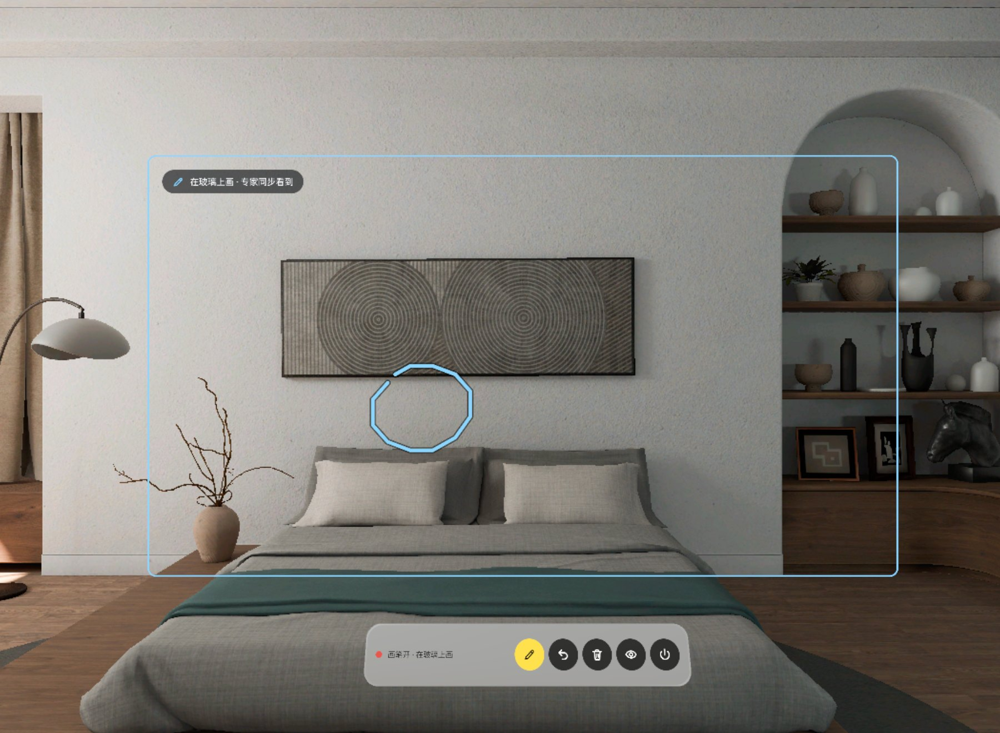

# 千里眼 Qianliyan


远程协助，做成 PICO OS 6（Swan）的空间应用。戴头显的现场人员把**眼前的真实画面**分享给电脑前的专家，两边可以**直接说话**；专家在浏览器里的视频上画，笔迹同一时刻出现在现场人员眼前一块跟着视野走的透明「视野玻璃」上；现场人员也能在玻璃上画蓝笔，专家那边同步看到。

Remote assistance as a PICO OS 6 (Swan) spatial app. The worker wearing the headset shares **the real view from the headset cameras** with an expert at a computer, and the two can **talk to each other**. The expert draws on the live video in a browser; the chalk lines appear at the same moment on a head-locked transparent "visor glass" in front of the worker's eyes. The worker can draw back in blue, and the expert sees it on the video.



> **当前状态 / Status (v0.2.0)**
>
> - **真机 Swan 上验证过**：专家网页看到头显的真实画面（1024 × 768，约 15 fps），双向语音能收发。Verified on a real Swan: the expert page shows the headset's real view (1024 × 768, about 15 fps) and voice works both ways.
> - 还没确认：回声（戴着头显外放说话时）、嘴到耳延迟、画面延迟的实测常数、1 m 实物对齐、跨网段的 https。Not yet checked: acoustic echo, mouth-to-ear delay, the measured video latency, alignment with a real object at 1 m, https across networks.
> - 模拟器没有摄像头，在模拟器上专家看到的是合成的演示画面（带「演示画面 · 模拟器没有摄像头」提示）。The emulator has no camera; there the expert sees a synthetic demo picture.
> - 模拟器截图和演示视频由调试命令驱动，**不是真实手势录像**。Emulator screenshots and the demo video are driven by debug commands. **They are not recordings of real hand gestures.**

## 截图 Screenshots

| | |
| --- | --- |
|  |  |
| **专家台 · 真机画面**：头显摄像头的真实画面，15 fps，延迟约 20 ms（USB）。Expert page with the real headset view (Swan). | **双向语音**：现场说话时专家台顶部显示「现场在说话」；专家可静音。Voice: 「现场在说话」 shows while the worker talks. |
|  |  |
| **配对卡**：地址 + 4 位 PIN，摄像头 / 麦克风两行授权状态，连不上时的热点 / USB 办法。Pairing card: address, PIN, camera and mic rows, help when the network blocks you. | **通话条**：🎙 ✎ ↶ 🗑 ◉ ⏻ 六个键；从上到下是通话中、我已静音、对方说话、打开摄像头、画面不可用、语音重连、专家只能听、已暂停。The call strip in eight states. |
|  |  |
| **专家画的黄圈**出现在头显视野玻璃的同一位置（模拟器）。The expert's yellow circle on the visor glass (emulator). | **现场人员开画笔**：玻璃保持透明，手在玻璃上画蓝线（模拟器）。The worker draws in blue (emulator). |

真机截图来自专家网页（头显屏幕熄灭时系统截不了头显内画面）；配对卡、通话条、视野玻璃截图来自 PICO 6.1 模拟器。Real-device shots are of the expert page; the pairing card, strip and glass shots come from the emulator.

演示视频 Demo video: [docs/media/Qianliyan-demo.mp4](docs/media/Qianliyan-demo.mp4)（v0.1.3，56 s，模拟器，调试输入驱动，无声，非真实手势录像 / v0.1.3, emulator, debug-driven, silent, not real gestures）。

## 怎么连 How to connect

头显自己跑一个网页服务，不经过任何云服务、不用账号。三种接法，选一种：
The headset hosts the expert page itself (no cloud, no account). Pick one way to connect:

**A. 同一 Wi-Fi（推荐，能通话）Same Wi-Fi (recommended, with voice)**

1. 头显上打开千里眼，配对卡上有地址（如 `192.168.1.23:8765`）和 4 位 PIN。Open the app; the pairing card shows the address and the PIN.
2. 电脑浏览器打开 `http://<头显 IP>:8765`。页面会提示「为了能通话，要换到安全地址」，点 **继续**，跳到 `https://<头显 IP>:8766`。Open `http://<headset IP>:8765`; the page asks to switch to the secure address `https://<headset IP>:8766`.
3. **第一次**浏览器会说「不安全」：点 **高级** → **继续前往**。证书是头显自己签的，只在这台头显和电脑之间用；之后这台电脑直接进。**The first time** the browser warns about the certificate: choose Advanced → Proceed. The certificate is self-signed by the headset; you only accept it once per computer.
4. 输 PIN，允许麦克风，就能看画面、说话、画。Enter the PIN and allow the microphone.

不想通话也可以点「先不通话，只看画面」，留在 http 上（只能听、不能说）。You can also stay on http without voice ("先不通话，只看画面").

**B. USB 线（电脑就在旁边）USB cable (computer next to the headset)**

```bash
adb forward tcp:8765 tcp:8765
```

然后打开 `http://localhost:8765`，输 PIN。localhost 本身就是安全地址，不用证书，麦克风直接能用。Then open `http://localhost:8765` and enter the PIN. localhost counts as secure, so the microphone works without a certificate.

**C. 手机热点 Phone hotspot**：头显和电脑都连同一个手机热点，再按 A 的步骤走。Put the headset and the computer on the same phone hotspot, then follow A.

> **公司 Wi-Fi 常常连不上 / Corporate Wi-Fi often blocks this.** 很多公司网络把无线客户端互相隔离，或者头显和电脑分在不同网段（我们测试时头显在 `30.16.x.x`、电脑在 `10.73.x.x`，直连超时）。这不是应用的问题：换手机热点（C）或 USB（B）。公司浏览器策略如果拦掉「继续前往」，也用 B 或 C。Many company networks isolate wireless clients or put devices on different subnets, so the computer cannot reach the headset. Use a phone hotspot (C) or USB (B). If a managed browser hides "Proceed", use B or C too.

戴耳机通话效果最好；头显这边开了系统回声消除和降噪。Headphones on the expert side work best; the headset uses the system echo canceller and noise suppressor.

## 用起来 Using it

- 专家在视频上画：3 种颜色、3 种粗细，可撤销、清除、8 秒自动淡出，悬停是黄点指点；笔迹出现在头显正前方 1 m 的视野玻璃上。The expert draws (3 colours, 3 widths, undo, clear, 8 s fade, hover pointer); strokes appear on the glass 1 m ahead.
- 现场人员的通话条：🎙 静音、✎ 画笔、↶ 撤销、🗑 清除、◉ 暂停共享、⏻ 结束。The worker's strip: mute, pen, undo, clear, pause sharing, end.
- 断线 30 秒内回到同一会话；结束后清空笔迹、回到配对并换新 PIN。Reconnects to the same session within 30 s; ending clears the strokes and issues a new PIN.

## 安装 Install

```bash
adb install -r Qianliyan-v0.2.0.apk
pico-cli app launch io.embodit.jieyan
```

APK 在 [Releases](../../releases) 里（debug 签名）。第一次打开会请求摄像头和麦克风权限。The APK (debug-signed) is attached to the release. The app asks for camera and microphone permission on first launch.

## 构建 Build

```bash
./gradlew assembleDebug
adb install -r app/build/outputs/apk/debug/app-debug.apk
```

Needs the PICO Spatial SDK 6.1.9 (`PICO_HOME`) and JDK 21. Package `io.embodit.jieyan` (the app was renamed from 借眼 Jieyan; package and class names keep the old name).

## 技术 Tech

- PICO Spatial SDK 6.1.9, Kotlin. One Mixed Stage (passthrough). All 2D UI is SpatialUI (`com.pico.spatial.ui.*`) inside `PicoTheme`; no Material.
- **Real view**: `VstReadbackCameraSource` uses SpatialML Readback Mode (`rectifiedVSTAccess` → `convertColor` → readback), 1024 × 768 (square pixels, picked from the camera intrinsics), JPEG over WebSocket. On the Swan: 14.6 fps average over 60 s, readback 4 ms + JPEG 9–10 ms per frame, first frame 0.3 s after the expert joins. The emulator falls back to `SyntheticCameraSource`.
- **Voice**: `VoiceEngine` — 16 kHz mono PCM, `AudioRecord(VOICE_COMMUNICATION)` with AEC + NS, 60 ms jitter buffer, on a second WebSocket. The page captures and plays with AudioWorklet; the expert's mic is held while the worker speaks, as an echo fallback.
- **https**: `TlsGateway` serves `:8766` with a self-signed certificate (SAN = the headset's LAN IPs + 127.0.0.1), because browsers only open the microphone on secure origins.
- Visor glass: head-locked through a camera anchor, sized from the camera intrinsics so a point on the video lands on the same place in view.
- Ktor CIO server: expert page (`app/src/main/assets/expert.html`, one file, no external resources), WebSocket, PIN gate (60 s lock after 5 wrong tries), reconnect within 30 s.

## 已验证 / 待确认 Verified / to check

| 项 Item | 状态 Status |
| --- | --- |
| 真机装机、启动、配对卡 Install, launch, pairing card on a Swan | ✓ 用户真机验过 2026-10-22 |
| 专家台看到头显真实画面，约 15 fps Real view on the expert page | ✓ 真机 |
| 双向语音收发、两边静音 Voice both ways, mute | ✓ 真机（电脑侧用浏览器测试麦克风） |
| USB `adb forward` 接入 Joining over USB | ✓ 真机 |
| https 自签证书 + 开麦 https with the self-signed cert | ✓ 真机（经 USB 转发、非 localhost 主机名），跨网段待确认 |
| 回声（戴头显外放说话）Acoustic echo with a person wearing it | 待确认 |
| 嘴到耳延迟 Mouth-to-ear delay | 待确认 |
| 画面延迟常数（手机秒表实测）Video latency constant (stopwatch) | 待确认 |
| 1 m 外实物对齐 Glass alignment with a real object at 1 m | 待确认 |
| 摄像头 / 麦克风系统权限弹窗 System permission dialogs | 待确认 |
| 同一 Wi-Fi / 热点跨设备接入，Chrome 和 Edge Joining over Wi-Fi or hotspot | 待确认（公司 Wi-Fi 隔离，没测成） |

## 文档 Docs

- [design/v3-vst-voice.md](design/v3-vst-voice.md): what changed in v0.2.0 (real view, voice, https, new pairing card and call strip).
- [design/design-doc.md](design/design-doc.md), [design/networking.md](design/networking.md), [design/preview.html](design/preview.html), [design/design-package.json](design/design-package.json): the accepted design package.
- [AGENTS.md](AGENTS.md): guidance for coding agents (debug commands, QA screenshot lists, device facts learned the hard way).

## 字体 Font

Bundled fonts Noto Sans and Noto Sans SC (subset): SIL Open Font License (`third_party/`).
