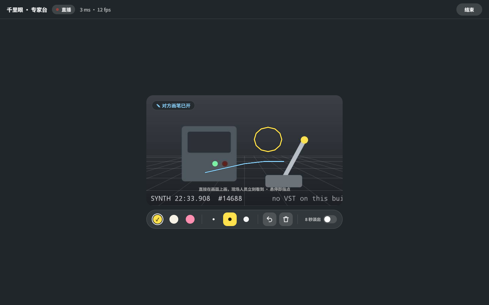
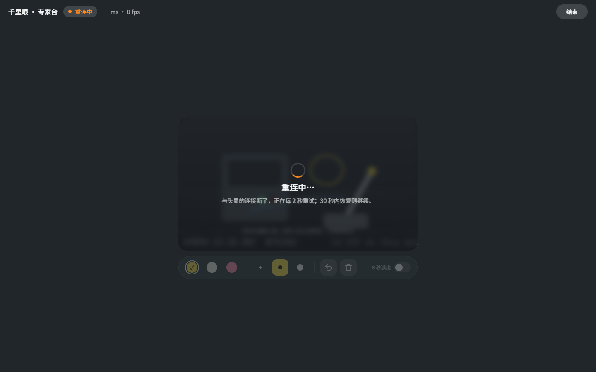
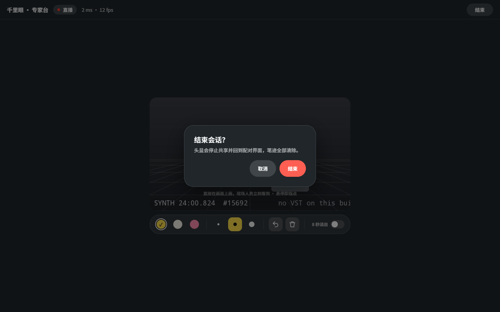

# 千里眼 Qianliyan


远程协助，做成 PICO OS 6（Swan）的空间应用。戴头显的现场人员把眼前的画面分享给电脑前的专家；专家在浏览器里的视频上直接画，笔迹同一时刻出现在现场人员眼前一块跟着视野走的透明「视野玻璃」上；现场人员也能在玻璃上画蓝笔，专家那边同步看到。

Remote assistance as a PICO OS 6 (Swan) spatial app. The worker wearing the headset shares what they see with an expert at a computer; the expert draws on the video in a browser, and the chalk lines appear at the same moment on a head-locked transparent "visor glass" in front of the worker's eyes. The worker can draw back in blue, and the expert sees it on the video.


> **当前状态 / Status (v0.1.3)**
>
> - 只在 PICO 6.1 模拟器上验证过，还没在真机上跑过。Verified on the PICO 6.1 emulator only; not yet run on a headset.
> - **真机相机读回还没实现**（`VstReadbackCameraSource.IMPLEMENTED = false`）。装到真机上，专家网页看到的仍是合成的「SYNTH」演示画面，不是头显的真实视野。**The VST camera readback is not implemented yet.** On a real headset the expert page still shows the synthetic "SYNTH" demo picture, not the headset's real view.
> - 截图和视频都来自模拟器，由调试命令驱动，**不是真实手势录像**。Screenshots and video come from the emulator, driven by debug commands. **This is not a recording of real hand gestures.**

## 截图 Screenshots

| | |
| --- | --- |
|  |  |
| **配对卡**：局域网地址 + 4 位 PIN，专家在浏览器里打开地址、输 PIN 就能接入。Pairing card: LAN address and a 4-digit PIN. | **专家画的黄圈**出现在头显视野玻璃的同一位置。The expert's yellow circle on the visor glass. |
|  |  |
| **现场人员开画笔**：玻璃保持透明，蓝框 + 提示，手在玻璃上画蓝线。Pen on: the glass stays see-through; the worker draws in blue. | **专家台**：黄圈和现场的蓝线都在视频上，顶部提示「对方画笔已开」。Expert page with both strokes. |
|  |  |
| **断线重连**：两侧都显示「重连中」，30 秒内恢复同一会话。Reconnecting; the same session resumes within 30 s. | **结束会话**：头显停止共享、清空笔迹、回到配对并换新 PIN。End session: sharing stops and a new PIN is issued. |

演示视频 Demo video: [docs/media/Qianliyan-demo.mp4](docs/media/Qianliyan-demo.mp4)（56 s，PICO 模拟器，调试输入驱动，无声，非真实手势录像 / emulator, debug-driven, silent, not real gestures）。

## 怎么用 How it works

1. 头显上打开千里眼，配对卡显示 `http://<头显 IP>:8765` 和 4 位 PIN。Open the app; the pairing card shows the address and PIN.
2. 同一 Wi-Fi 下的电脑用浏览器打开这个地址，输 PIN。On a computer on the same Wi-Fi, open the address and enter the PIN.
3. 专家在视频上画（3 种颜色、3 种粗细，可撤销、清除、8 秒自动淡出），笔迹出现在头显正前方 1 m 的视野玻璃上。The expert draws; the strokes appear on the glass 1 m in front of the worker.
4. 现场人员点 ✎ 在玻璃上画蓝笔；通话条还能撤销、清除、暂停共享、结束。The worker's strip has pen, undo, clear, pause sharing and end.

连接方式：头显自己跑一个 HTTP + WebSocket 服务（Ktor CIO，端口 8765），画面是 MJPEG 帧，只走局域网，不经过任何云服务。语音不在本应用里（建议同时打电话）。The headset hosts the page and the WebSocket on :8765 (LAN only, MJPEG frames, no cloud). No audio: use a phone call alongside.

## 安装 Install

```bash
adb install -r Qianliyan-v0.1.3.apk
pico-cli app launch io.embodit.jieyan
```

APK 在 [Releases](../../releases) 里。The APK is attached to the release.

## 构建 Build

```bash
./gradlew assembleDebug
adb install -r app/build/outputs/apk/debug/app-debug.apk
```

Needs the PICO Spatial SDK 6.1.9 (`PICO_HOME`) and JDK 21. Package `io.embodit.jieyan` (the app was renamed from 借眼 Jieyan; package and class names keep the old name).

## 技术 Tech

- PICO Spatial SDK 6.1.9, Kotlin. One Mixed Stage (passthrough). All 2D UI is SpatialUI (`com.pico.spatial.ui.*`) inside `PicoTheme`; no Material.
- Visor glass: head-locked through a camera anchor, sized from the camera intrinsics so a point on the video lands on the same place in view.
- Pairing card and call strip follow lazily (ECS frame system); per-frame work never goes through Compose.
- Ktor CIO server: expert page (`app/src/main/assets/expert.html`, one file, no external resources), WebSocket, PIN gate (60 s lock after 5 wrong tries), reconnect within 30 s.
- Camera: `SyntheticCameraSource` (drawn workbench, 640 × 360 @ 12 fps) runs on the emulator and, for now, on a device. `VstReadbackCameraSource` holds the SpatialML Readback contract but is not implemented.

## 真机待验 To check on a headset

1. 真实画面：实现 VST 读回后，专家网页应是头显看到的真实场景，不再有 SYNTH 水印。Real picture after VST readback is implemented.
2. 帧率与延迟：网页 ≥ 12 fps，读回每帧 < 40 ms。Frame rate ≥ 12 fps, readback < 40 ms per frame.
3. 对齐：1 m 外放一个已知物体，专家圈住它，头显玻璃上的黄圈应正好套住真实物体。Alignment of the glass with a real object at 1 m.
4. 相机权限：拒绝后配对卡出现 [授权]，点它弹出系统权限框。Camera permission flow.
5. 头锁定手感：转头、走动时玻璃始终在正前方 1 m，不晃不拖影。Head-lock feel.
6. 毛玻璃：⏻ → 是 回配对 5 次以上，配对卡没有黑块；画笔开时玻璃无黑带。Glass panels stay clean on a headset.
7. 真实手势画线：手在玻璃上拖出蓝线，网页同步；通话条 5 个键都能点中。Real hand drawing and key presses.
8. 同一 Wi-Fi 接入：电脑浏览器打开配对卡上的真实局域网地址，输 PIN 能接入。Joining from a computer on the same Wi-Fi.

## 文档 Docs

- [design/design-doc.md](design/design-doc.md), [design/networking.md](design/networking.md), [design/preview.html](design/preview.html), [design/design-package.json](design/design-package.json): the accepted design package (v2).
- [AGENTS.md](AGENTS.md): guidance for coding agents (debug commands, QA screenshot list, emulator facts learned the hard way).

## 字体 Font

Bundled fonts Noto Sans and Noto Sans SC (subset): SIL Open Font License (`third_party/`).
